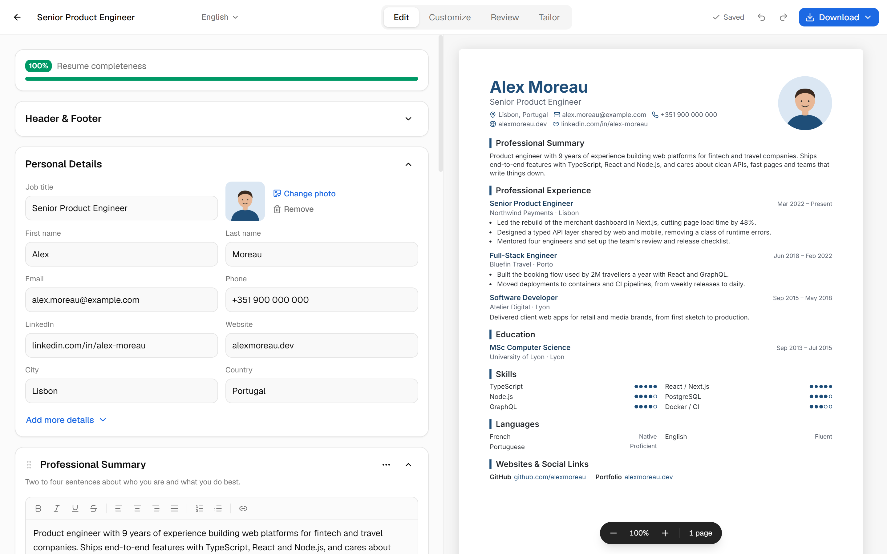
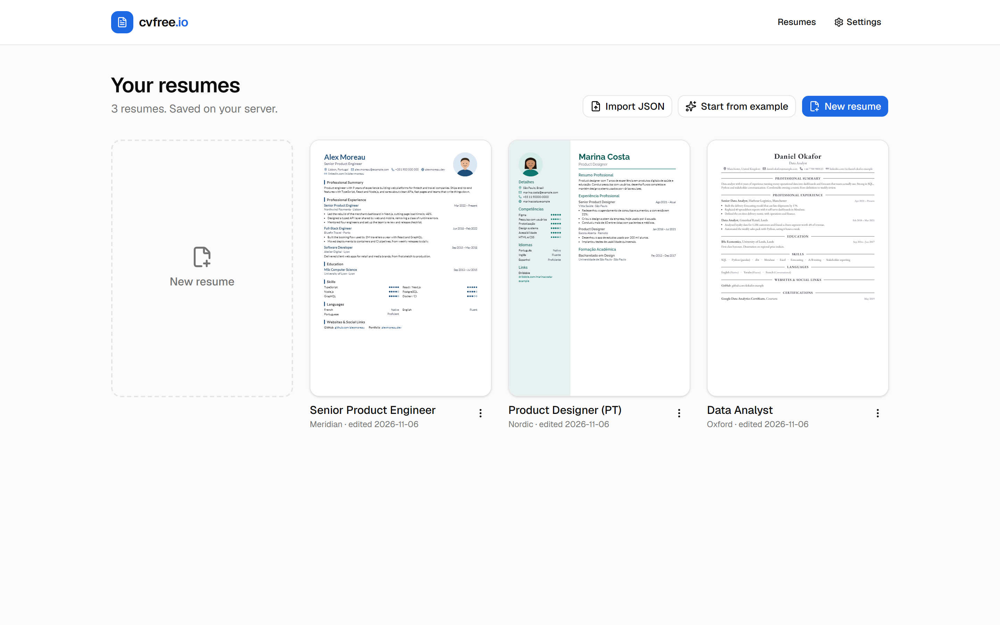
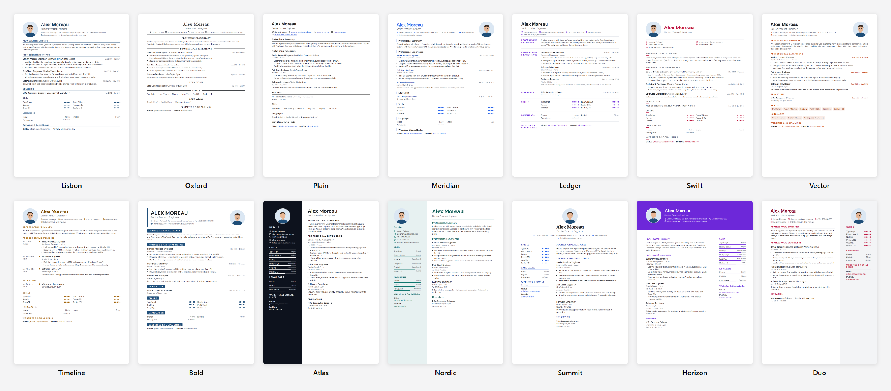
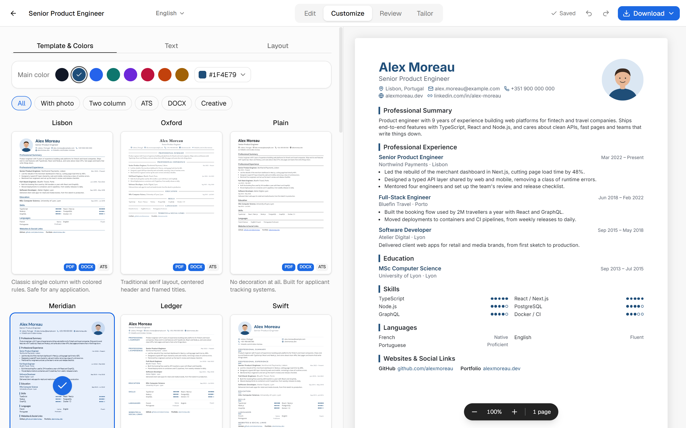
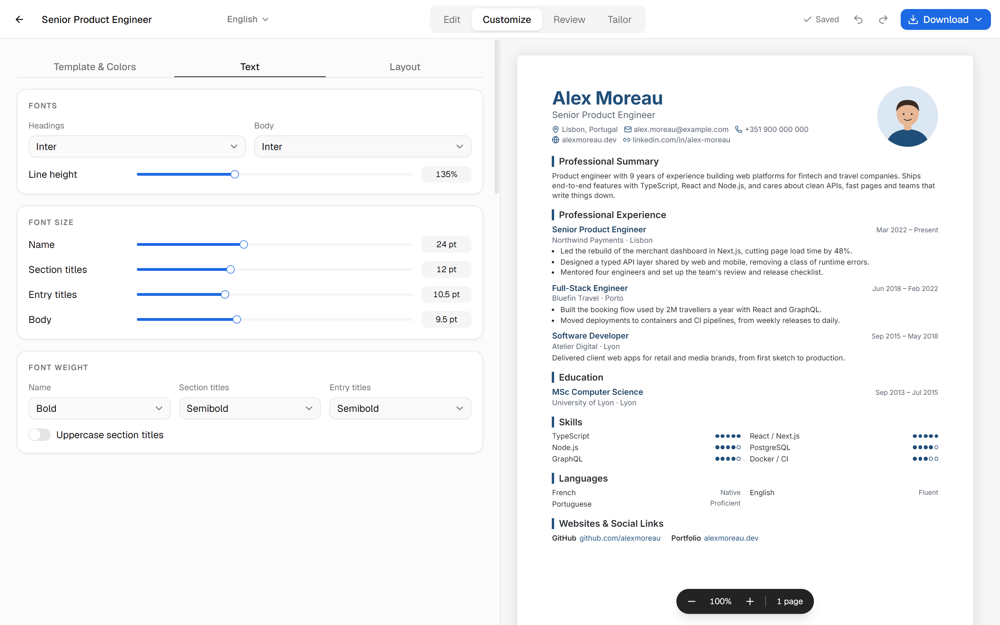
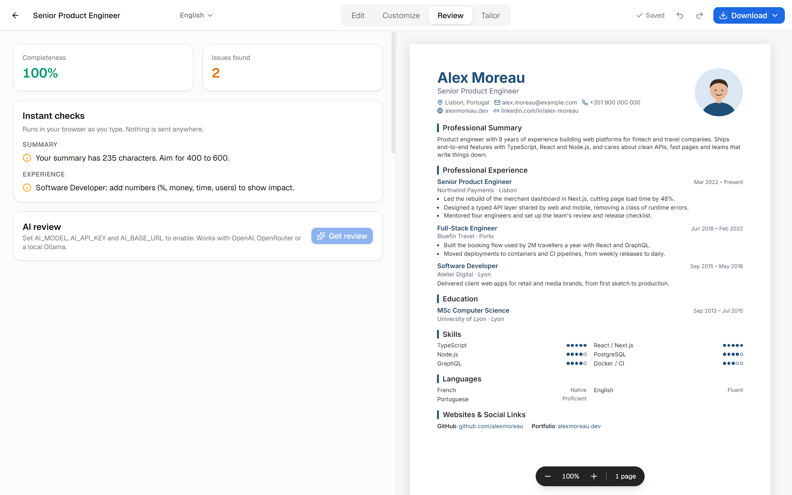
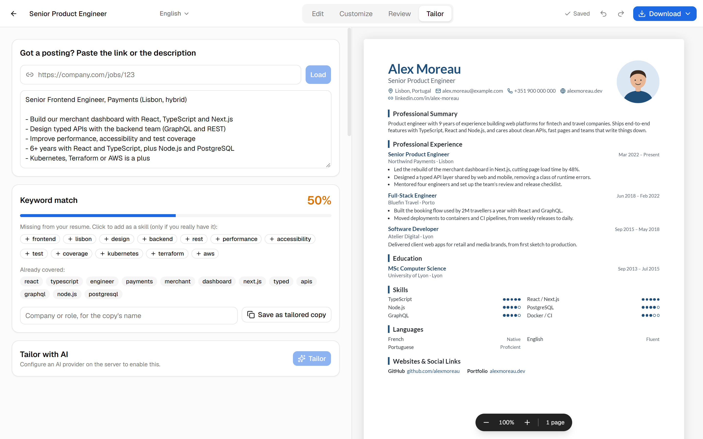
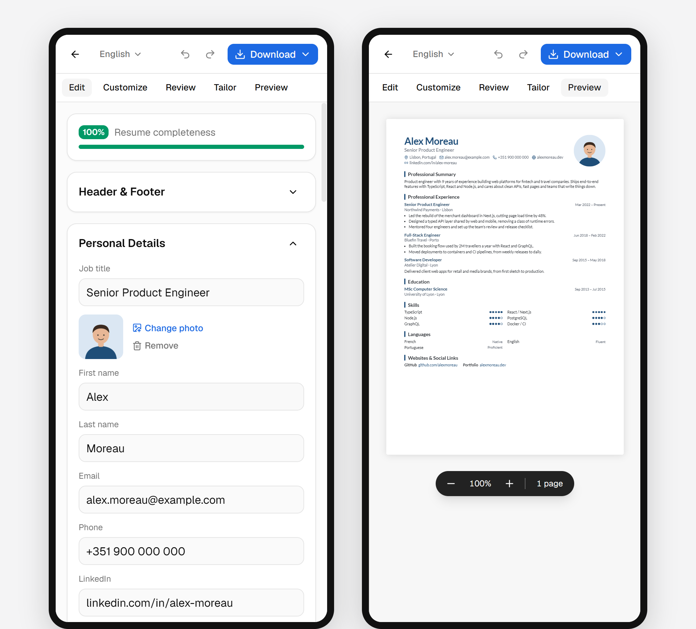
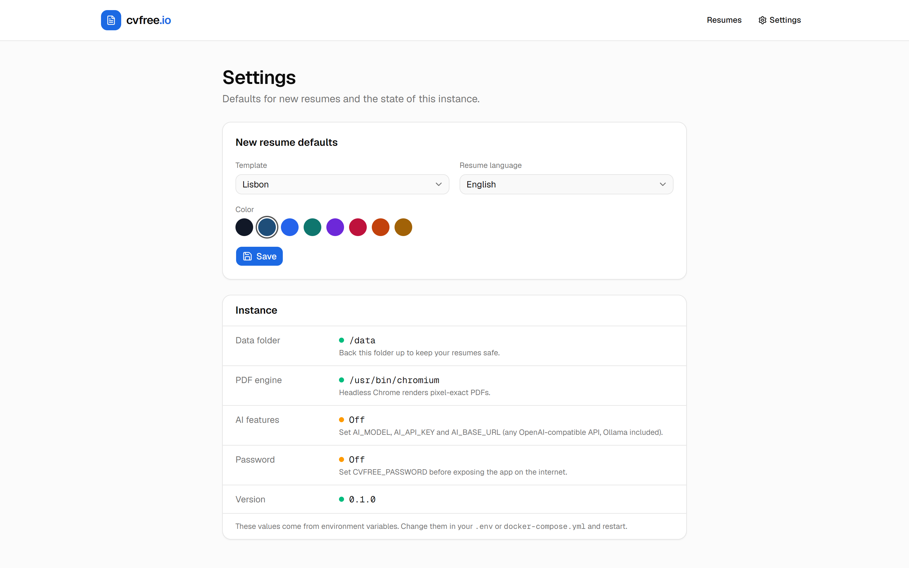

# cvfree.io

Open-source, self-hosted resume builder. Edit on the left, see the page update on the right, switch templates at any time and export to PDF, Word, plain text or JSON. Your data stays on your server as plain JSON files.

Built with Next.js 16, React 19, Tailwind CSS 4, shadcn/ui (Base UI) and ReUI.



## Features

- **Live editor.** Every keystroke shows up in the A4 or Letter preview, with page break guides, page count and zoom.
- **14 templates.** Single column, two column, ATS friendly, with photo, creative. Switch any time without losing content.
- **Deep customization.** Color (presets or any custom color), heading and body fonts (15 self-hosted fonts), font sizes and weights, line height, margins, spacing, date format, header alignment, skills layout, photo shape and size.
- **All the usual sections.** Summary, experience, education, skills, languages, links, projects, certifications, courses, internships, volunteering, awards, publications, hobbies, references, plus custom sections. Drag to reorder sections and entries, rename, hide, or move between columns.
- **Photo upload** with a crop dialog. Stored inside the resume, so backups are self-contained.
- **Header, footer and page numbers** (1, 1/3 or Page 1 of 3) on every PDF page.
- **Exports.** Pixel-exact PDF (headless Chromium), DOCX, TXT and a JSON backup you can import again.
- **Review.** Completeness score and instant writing checks (missing dates, no numbers, passive phrases, summary length...).
- **Tailor.** Paste a job link or description, get a keyword match score and add missing skills in one click. Save a tailored copy.
- **Optional AI** review and tailoring with any OpenAI-compatible API, including a local Ollama.
- **Resume language** for section titles and dates: English, Portuguese, Spanish, French, German.
- **Undo and redo**, autosave, optional password protection.

## A quick tour

Every person, company and link in these screenshots is made up.

### Dashboard

All your resumes, each with a live thumbnail of its current template. Create a blank one, start from a filled-in example, or import a JSON backup. The menu on each card renames, duplicates, downloads or deletes it.



### Editor

The form is on the left and the page is on the right. There is no save button: changes show up in the preview as you type and are saved a moment later. The bar on top shows how complete the resume is. Sections fold, can be dragged into a new order, renamed, hidden or moved to the other column. The Download menu exports PDF, Word, plain text and a JSON backup.

### Templates

Fourteen templates, all fed by the same content, so switching never loses anything. Filter by photo, two column, ATS or DOCX. Each template brings its own fonts and spacing, and you can change all of it afterwards.



### Customize

The Customize tab has three parts. **Template & Colors** picks the design and the main color, from a preset or any color you like. **Text** sets the fonts, sizes, weights and line height. **Layout** covers page size, margins, spacing, date format and position, skills layout and the photo.





### Review

Instant checks that run in the browser as you type: missing contact details, a summary that is too short or too long, jobs without dates or numbers, passive phrases such as "responsible for". Nothing leaves your server. If you connect an AI provider, the same tab can ask it for a full review.



### Tailor

Paste a job posting, or its link, and see which of its keywords your resume already covers. Click a missing keyword to add it as a skill, then save a tailored copy for that application and keep the original as it is.



### On a phone

The editor works on small screens too. Switch between the form and the preview with the tabs on top.

<p align="center"></p>

### Settings

Defaults for new resumes (template, language and color), and a status panel that shows where data is stored, which browser renders PDFs, and whether AI and the password are on.



## Quick start with Docker

You need Docker with the compose plugin.

```bash
git clone https://github.com/samuelbelo/cvfree.git
cd cvfree
cp .env.example .env
docker compose up -d
```

Open `http://localhost:3000` (or `http://your-server-ip:3000`).

Resumes live in the `cvfree-data` Docker volume. They survive restarts and upgrades.

### On a VPS with your own domain and HTTPS

1. Point an A record for your domain (for example `cv.example.com`) to the server.
2. In `.env`, set `DOMAIN=cv.example.com` and a `CVFREE_PASSWORD`.
3. Start with the HTTPS profile. Caddy gets a Let's Encrypt certificate on its own.

```bash
docker compose --profile https up -d
```

Open `https://cv.example.com`.

### Update

```bash
git pull
docker compose up -d --build
```

### Backup and restore

```bash
docker run --rm -v cvfree_cvfree-data:/data -v "$PWD":/backup alpine tar czf /backup/cvfree-backup.tgz -C /data .
```

```bash
docker run --rm -v cvfree_cvfree-data:/data -v "$PWD":/backup alpine tar xzf /backup/cvfree-backup.tgz -C /data
```

Each resume is also downloadable as JSON from the editor and can be imported from the dashboard.

## Configuration

All settings are environment variables. Set them in `.env` when using compose.

| Variable | Default | What it does |
| --- | --- | --- |
| `CVFREE_PORT` | `3000` | Host port (compose only) |
| `CVFREE_BIND` | `0.0.0.0` | Interface the port is published on. Use `127.0.0.1` with the HTTPS profile, so only Caddy is reachable. |
| `CVFREE_PASSWORD` | empty | Password gate for the whole app. Set it on any public server. |
| `DOMAIN` | empty | Domain for the optional Caddy HTTPS proxy |
| `DATA_DIR` | `/data` in Docker, `./data` locally | Where resumes and settings are stored |
| `CHROME_PATH` | auto | Chrome or Chromium binary for PDF export. Found automatically on most systems. |
| `INTERNAL_URL` | `http://127.0.0.1:$PORT` | URL the PDF renderer uses to reach the app |
| `AI_BASE_URL` | `https://api.openai.com/v1` | Any OpenAI-compatible endpoint |
| `AI_API_KEY` | empty | API key for the endpoint (not needed for Ollama) |
| `AI_MODEL` | empty | Model name. AI features stay off until this is set. |

The Settings page in the app shows which of these are active, and lets you pick defaults for new resumes.

## Security notes

- **One password, one workspace.** `CVFREE_PASSWORD` protects the whole instance. Everyone who knows it sees and edits every resume. It is made for one person or one household, not for a public service with accounts.
- **Without a password, anyone who can reach the port can read and change every resume.** Keep the port on your LAN or behind a VPN, or set the password.
- **Job postings are fetched from public addresses only.** The Tailor tab refuses links to localhost, private networks, cloud metadata addresses and anything that redirects there. Pasting the text always works.
- **Rich text is cleaned on save and on render.** Only paragraphs, lists, bold, italic, underline, strike, alignment and `http`, `https`, `mailto` or `tel` links survive, including in imported JSON.
- **Logins are rate limited** per client address, and the session cookie is `HttpOnly`, `SameSite=Lax` and `Secure` behind HTTPS.
- Found a problem? Open an issue without personal data, or email the maintainer address on the GitHub profile for anything sensitive.

## Local development

Requirements: Node.js 22 or newer, pnpm, and Chrome, Chromium or Edge installed for PDF export.

```bash
pnpm install
pnpm dev
```

Open `http://localhost:3000`. Data is written to `./data`.

```bash
pnpm build && pnpm start
```

## How it works

- `src/lib/resume/schema.ts` defines the resume document with zod. The editor state, the JSON on disk and the export format share this one shape.
- `src/store/editor-store.ts` is a zustand store. Forms write to it, the preview reads from it, and autosave sends it to the API after a short pause.
- `src/templates` holds the rendering. `blocks.tsx` renders sections the same way for every template, each design in `designs/` only decides structure, and `cv.css` styles everything from CSS variables built from the settings. Units are print units (mm, pt), so the preview and the PDF match.
- `src/app/print/[id]` is a bare page with only the resume. The PDF export opens it in headless Chromium and prints it, then stamps page numbers with pdf-lib.
- `src/lib/server/repo.ts` stores one JSON file per resume. Swap this module to use a database.

## Adding a template

1. Write a component in `src/templates/designs/` that takes `{ ctx }` and composes the blocks (`Sections`, `ContactLine`, `Photo`...).
2. Add its styles to `src/templates/cv.css` under `.cv[data-template="your-id"]`.
3. Register it in `src/templates/registry.ts` with a name, tags and default fonts.

It then shows up in the template picker with a live thumbnail.

## License

MIT
